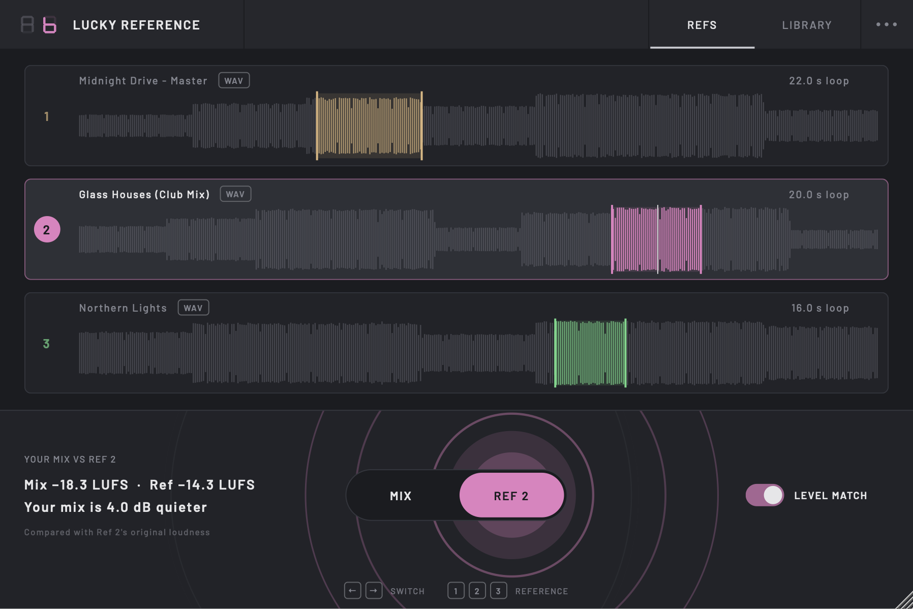
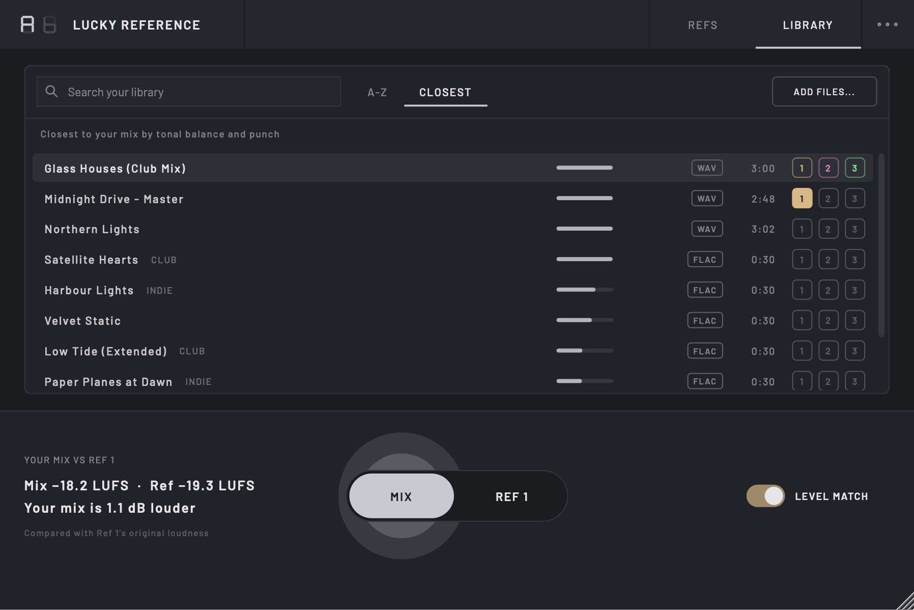

# Lucky Reference

Compare your mix against reference tracks at matched loudness. Lucky Reference sits last on your master track: load up to three references, choose the section of each to compare, and flip between your mix and a reference with one switch. A reference library keeps your tracks one search away and ranks them by how close they sound to your mix.

**[Website and download](https://tomdmaguire.github.io/lucky-reference/)** · a sibling of [Lucky Seven](https://github.com/tomdmaguire/lucky-seven) · product spec in [`docs/spec.md`](docs/spec.md)





## Install

Download [**Lucky-Reference.pkg**](https://github.com/tomdmaguire/lucky-reference/releases/latest/download/Lucky-Reference.pkg) and open it. It installs the VST3 and AU (Apple Silicon and Intel) into `/Library/Audio/Plug-Ins`.

Lucky Reference isn't signed with a paid Apple developer certificate, so macOS won't open the installer the first time. Click **Done**, then go to **System Settings → Privacy & Security**, scroll down and click **Open Anyway**.

A zip for installing by hand is also on the [releases page](https://github.com/tomdmaguire/lucky-reference/releases/latest); its `INSTALL.txt` explains the steps.

## Features

- **Three reference slots**: drop a WAV, AIFF, FLAC, MP3 or M4A file onto a slot, click it to browse, or load one from the library. Hover a slot and click × (or press Delete) to remove its reference.
- **A loop for each reference**: a new reference loops its loudest 16 seconds. Drag across the waveform to choose another section, drag a loop edge to adjust it, double-click to play the whole track.
- **One A/B switch** in the middle, with a short crossfade. Press ← for your mix, → for the reference and 1/2/3 to choose a slot. It's also the first plugin parameter, so in Ableton you can add it to the device panel (Configure) and MIDI- or key-map it.
- **Loudness matching**: the reference is turned to your mix's BS.1770 loudness, measured over the last 10 seconds you've played and the reference's loop. Flip the LEVEL MATCH switch off to hear the real gap.
- **Loudness readout**: both LUFS values and the gap in plain words ("Your mix is 3.4 dB quieter"). It always compares real, unmatched levels.
- **Reference library** (the LIBRARY tab): every track in `~/Music/Lucky Reference/References`, plus any folders you add from the **⋯** menu (indexed in place, never copied). Search by name or folder, and load a track into reference 1, 2 or 3 with the buttons on its row; replacing a loaded reference asks first. ADD FILES copies files in, and a reference loaded from elsewhere offers ADD TO LIBRARY.
- **Closest to your mix**: after 20 seconds of playing, CLOSEST ranks the library by how close each track's tonal balance (third-octave bands, loudness removed) and punch are to your mix. The order stays put while you browse; if more playing changes your top three, an UPDATE button offers to re-rank. Library tracks are analysed once in the background and cached.
- **Format badge** next to each reference's name, with the bitrate for lossy files ("MP3 · 192 kbps"), so you know when you're comparing against a lower-quality file.
- **Keyboard**: left/right arrows switch between mix and reference, 1/2/3 pick a reference; the keys are shown under the switch.
- **Window size** from 75% to 200%: drag the corner or pick a size from the **⋯** menu.
- **Follows your transport**: references play when your DAW plays, and every reference restarts at its loop start when you press play.
- **Safe exports**: offline renders always contain your mix.
- **Light**: about 0.1% of the per-block time on average at 48 kHz, with the worst block under 6% at a 64-sample buffer. A 4-minute reference loads in about 0.3 s and holds about 90 MB.

References are linked by path, not copied into your project, so keep them where they are (the library is a good home), or relocate them from the slot if you move them.

Put Lucky Reference last on your master, after any limiter or mastering chain (monitor correction such as Sonarworks can come after it).

## Building

Requirements: macOS 13 or newer, Xcode (with the command line tools selected) and CMake 3.25 or newer. Ninja is optional but faster.

```sh
cmake -B build -G Ninja -DCMAKE_BUILD_TYPE=Release
cmake --build build
ctest --test-dir build --output-on-failure
```

### Tools

- `build/LuckyReferenceSnapshot <file.png> <mode>` renders the editor with generated references and a throwaway library. Modes: `empty`, `loaded`, `reference`, `measuring`, `nomatch`, `radar`, `playing`, `library`, `library-empty`, `library-replace`, `closest`, `closest-waiting`, `closest-update`, `outside`.
- `build/LuckyReferenceProfile [--stability] <files...>` prints each file's tonal profile and how closely every pair matches; `--stability` measures how much of a mix must play for a reliable ranking.
- `build/LuckyReferenceBench_artefacts/Release/LuckyReferenceBench` measures the engine's CPU use at 32-512 sample buffers, on the mix, on a reference and while flipping between them. Run it with nothing else busy (a DAW open skews the numbers).
- `build/LuckyReferenceLoadBenchmark_artefacts/Release/LuckyReferenceLoadBenchmark <file | --synthetic> [host rate]` times decoding, resampling and analysis.

### Release checks

Before tagging a release, on the installed build:

```sh
/Applications/pluginval.app/Contents/MacOS/pluginval --strictness-level 10 --validate-in-process --validate ~/Library/Audio/Plug-Ins/VST3/"Lucky Reference.vst3"
auval -v aufx Lref Lcky
lipo -info ~/Library/Audio/Plug-Ins/VST3/"Lucky Reference.vst3"/Contents/MacOS/"Lucky Reference"   # x86_64 arm64
leaks --atExit -- build/LuckyReferenceProcessorTests
```

Then add the version's entry to `CHANGELOG.md` and push a tag such as `v0.2.0`: GitHub Actions builds, tests, ad-hoc signs and publishes `Lucky-Reference.pkg` and a zip.

JUCE is fetched automatically by CMake. The build copies the VST3 and AU into `~/Library/Audio/Plug-Ins`.

## Licence

AGPLv3. The bundled Barlow fonts are under the SIL Open Font License (`Resources/Fonts/OFL.txt`).
